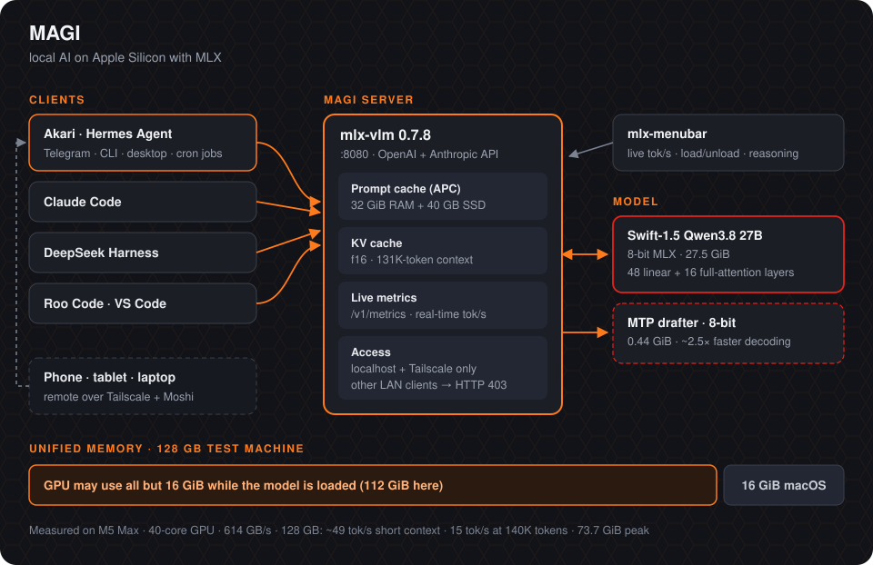
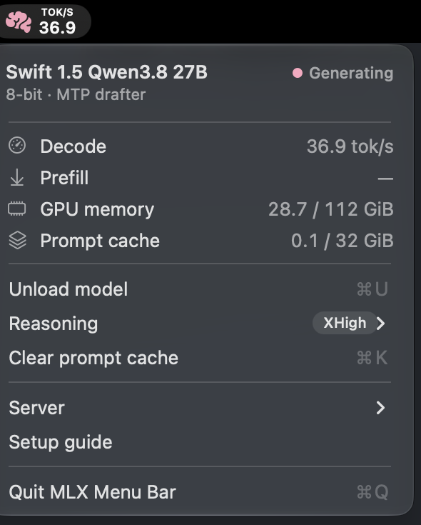
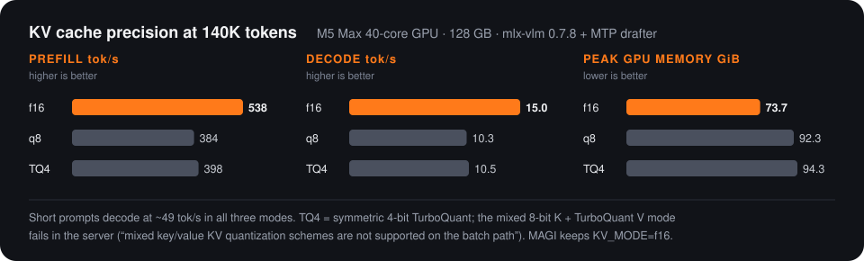
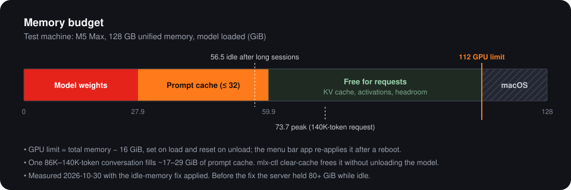

<p align="center">
  
</p>

<h1 align="center">MAGI</h1>

<p align="center">
  Local AI on Apple Silicon with MLX: an 8-bit Qwen3.8 27B with speculative decoding,<br>
  serving <b>Akari</b> (a Hermes Agent), Claude Code and other coding agents from one always-on Mac.
</p>

<p align="center">
  <a href="https://huggingface.co/robgaleano/Swift-1.5-Qwen3.8-27B-MLX-8bit"></a>
  <a href="https://huggingface.co/robgaleano/Swift-1.5-Qwen3.8-27B-MTP-MLX-8bit"></a>
  
  
</p>

<p align="center"></p>

## What's in this repo

| Folder | Contents |
| :--- | :--- |
| [`server/`](server) | `start-server.sh`, the `mlx-ctl` control script, the launchd service, pinned Python requirements, and the local `mlx-vlm` patch |
| [`menubar/`](menubar) | Native macOS menu bar app (Swift): live tok/s, memory, context size, load/unload, reasoning level |
| [`clients/`](clients) | Config examples for Akari (Hermes Agent), Claude Code (incl. context status line and `/handoff`) and DeepSeek Harness |
| [`docs/`](docs) | Setup, memory tuning, benchmarks, clients, headless operation, troubleshooting |
| [`server/quantize/`](server/quantize) | Scripts used to build and publish the 8-bit model on Hugging Face |

## The model

| | Hugging Face | Size | Notes |
| :--- | :--- | ---: | :--- |
| Main model | [`robgaleano/Swift-1.5-Qwen3.8-27B-MLX-8bit`](https://huggingface.co/robgaleano/Swift-1.5-Qwen3.8-27B-MLX-8bit) | 27.5 GiB | 8-bit MLX (`group_size=64`), vision + text |
| Drafter | [`robgaleano/Swift-1.5-Qwen3.8-27B-MTP-MLX-8bit`](https://huggingface.co/robgaleano/Swift-1.5-Qwen3.8-27B-MTP-MLX-8bit) | 0.44 GiB | Multi-token-prediction head for speculative decoding |

Both were converted locally from [UkisAI's Swift 1.5](https://huggingface.co/ukisai/Swift-1.5-Qwen3.8-27b), a fine-tune of Qwen3.8-27B, with `mlx-vlm 0.7.8` ([`server/quantize/`](server/quantize)). The model mixes 48 linear-attention layers with 16 full-attention layers, so the KV cache is small: about 8.6 GiB at 140K tokens.

## Quick start

Requirements: an Apple Silicon Mac with enough unified memory for ~28 GiB of weights plus context (64 GB is the practical minimum, 128 GB is comfortable), [`uv`](https://docs.astral.sh/uv/), Xcode Command Line Tools.

```bash
git clone https://github.com/robgaleano/magi.git ~/llm/magi
cd ~/llm/magi

./server/install.sh            # Python env + patched mlx-vlm + ~30 GB of weights + launchd service
mlx-ctl setup-memory-limit     # once: lets the GPU use all but 16 GiB of memory (admin password)
./menubar/install.sh           # menu bar app, starts at every login
sudo ./server/hardening/lan-lockdown.sh install   # recommended: Tailscale/localhost-only access

mlx-ctl mount                  # load the model
mlx-ctl status
```

The server then answers on `http://127.0.0.1:8080/v1` (OpenAI API) and `http://127.0.0.1:8080/v1/messages` (Anthropic API). Every request needs the API key the installer created in `~/.config/magi/api-key` ([docs/security.md](docs/security.md)). Details: [docs/setup.md](docs/setup.md).

## Menu bar

<p>
  &nbsp;&nbsp;
  
</p>

Monochrome brain when idle; pink and slowly pulsing with the **live** tok/s while the model is generating.



See [menubar/README.md](menubar/README.md).

## Performance

| Workload | Result |
| :--- | :--- |
| Short prompt, 512 tokens out, reasoning off | **48–50 tok/s** |
| Short prompt, 1,024 tokens out, `xhigh` reasoning | **37.6 tok/s** |
| Same model without the MTP drafter | 18.8 tok/s |
| 140K-token prompt, first time | 279 s (prefill 538 tok/s), then 15 tok/s |
| Same 140K prompt again, new question | **6.4 s** (139,264 tokens from the prompt cache) |
| Peak GPU memory across all tests | 73.7 GiB of 112 GiB, no swap |

<p align="center"></p>

Measured on the [test machine](#test-machine). More numbers and how to reproduce them: [docs/benchmarks.md](docs/benchmarks.md).

## Memory

<p align="center"></p>

How the GPU limit, prompt cache and idle-memory fix work: [docs/memory.md](docs/memory.md).

## Docs

- [Setup](docs/setup.md): install, `mlx-ctl`, the launchd service, upgrading and the local patch
- [Memory](docs/memory.md): 112 GiB GPU / 16 GiB macOS split, prompt cache sizing, idle-memory fix, KV cache choice
- [Benchmarks](docs/benchmarks.md): every measurement and how to repeat it
- [Clients](docs/clients.md): long sessions (context size vs speed), Akari (Hermes Agent), Claude Code, DeepSeek Harness, Roo Code
- [Headless operation](docs/headless.md): remote access, Telegram, sleep and reboot behaviour
- [Security](docs/security.md): API key, network access, firewall, what stays out of the repo
- [Troubleshooting](docs/troubleshooting.md): problems hit while building this, and their fixes

## Test machine

All numbers, screenshots and diagrams in this repo come from one machine:

> **Mac Studio, M5 Max (18-core CPU, 40-core GPU, 614 GB/s memory bandwidth), 128 GB unified memory, macOS 27**

Decode speed on Apple Silicon is mostly limited by memory bandwidth (every generated token reads the ~29.5 GB of weights), so expect roughly proportional results on other chips. Memory figures such as the 112 GiB GPU limit are for 128 GB; the scripts compute the limit as total memory − 16 GiB.

## Credits and licence

- **Swift 1.5** by [UkisAI](https://huggingface.co/ukisai/Swift-1.5-Qwen3.8-27b) (Swift Open License v1.0), based on **Qwen3.8-27B** by the Qwen team. The converted weights on Hugging Face keep the original licence files.
- **[MLX](https://github.com/ml-explore/mlx)** by Apple and **[mlx-vlm](https://github.com/Blaizzy/mlx-vlm)** by Prince Canuma, both MIT. `server/patches/` contains changes to `mlx-vlm`; its licence is in [`server/patches/LICENSE-mlx-vlm`](server/patches/LICENSE-mlx-vlm).
- **[Hermes Agent](https://github.com/NousResearch/hermes-agent)** by Nous Research.
- Code and docs in this repo: [MIT](LICENSE).
- `assets/akari.png`: avatar of Akari (灯り, "light"), an original AI-generated character made for this project.
