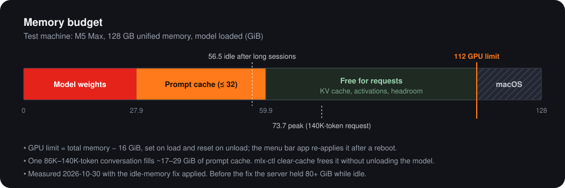
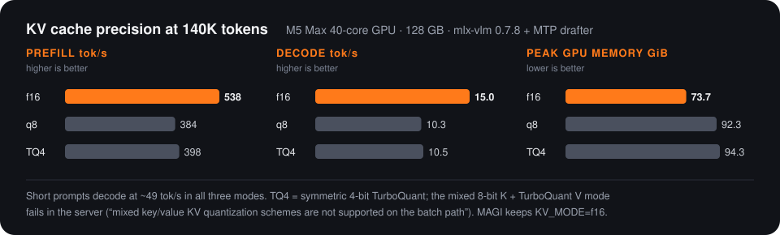

# Memory

<p align="center"></p>

Figures below were measured on the [test machine](../README.md#test-machine) (128 GB). Scale them to your memory size.

## GPU memory limit: all but 16 GiB

By default macOS caps how much unified memory the GPU may wire. MAGI raises the cap only while the model is loaded, to **total memory − 16 GiB** (overridable with `MLX_IOGPU_WIRED_LIMIT_MB`):

| State | `iogpu.wired_limit_mb` | Meaning |
| :--- | :--- | :--- |
| Model loaded | total − 16384 (`114688` on 128 GB) | GPU may use 112 GiB on 128 GB; 16 GiB always left for macOS and other apps |
| Model unloaded / server stopped | `0` | macOS default |

Who sets it:

- **The server** (`server/app.py` patch) on every load and unload.
- **`mlx-ctl mount` / `unmount`** and `start-server.sh` when preloading.
- **The menu bar app** as a safety net: it checks once a second and fixes a mismatch (at most one attempt every 30 s). This matters after a reboot, because `sysctl` values reset.

All of them use `sudo -n`, so they need a one-time passwordless rule limited to exactly these two commands:

```bash
mlx-ctl setup-memory-limit
```

which writes `/etc/sudoers.d/mlx-iogpu` (see [`server/sudoers.example`](../server/sudoers.example)):

```
youruser ALL=(root) NOPASSWD: /usr/sbin/sysctl -w iogpu.wired_limit_mb=<limit>, /usr/sbin/sysctl -w iogpu.wired_limit_mb=0
```

Check it: `sysctl -n iogpu.wired_limit_mb` while the model is loaded (`114688` on a 128 GB Mac).

## Prompt cache

The server keeps the KV state of recent prompts (Automatic Prefix Caching) so an agent that re-sends the same 50K-token conversation every turn only pays for the new part.

| Setting | Value |
| :--- | :--- |
| In RAM (`APC_MEMORY_MAX_GB`) | 32 GiB |
| On SSD (`APC_DISK_MAX_GB`) | 40 GB at `~/.cache/mlx-vlm/apc/` |
| Blocks / checkpoints / interval | 16384 / 24 / every 4096 tokens |

What fits, measured:

| Conversation | Prompt cache used |
| :--- | :--- |
| 86K tokens | ~28.6 GiB |
| 140K tokens | 17.0 GiB after the first request, 25.7 GiB after a follow-up |

So the RAM cache realistically holds **one** long agent session; the SSD tier holds one or two more. Switching between several long sessions means the evicted ones are rebuilt (an 86K-token rebuild took ~132 s). A follow-up in the cached session is fast: 6.4 s for a 140K-token prompt instead of 279 s.

The 40 GB disk cap applies **per cache folder**, and each model or `KV_MODE` change starts a new folder under `~/.cache/mlx-vlm/apc/`. After switching, delete the old folders — keep the one named in the latest `APC disk tier at …` line of `server.log`.

`mlx-ctl clear-cache` frees the RAM cache without unloading the model. Chat history lives in the clients (Hermes, Claude Code, …), so nothing is lost — the next request just rebuilds its prefix.

Why 32 GiB: on the 128 GB test machine, a full 32 GiB cache plus the model and a 140K-token request peaked at 73.7 GiB, far from the 112 GiB limit, with no swap. On a 64 GB Mac, start with `APC_MEMORY_MAX_GB=8`–`12`.

## Idle-memory fix

**Symptom (before the fix):** after a few 80K–86K-token requests the server held **83 GB while idle** (80.3 GiB of GPU memory).

**Cause:** about 31 GiB was the prompt cache, which is expected. The rest was a leak in `mlx-vlm 0.7.8`'s speculative-decoding path:
- the finished MTP batch kept its KV cache, hidden states and drafter state;
- the server only closed the batch when the *next* request arrived.

**Fix** (in the [local patch](setup.md#local-mlx-vlm-patch)): the batch frees its state when its last request finishes, and the server closes it and runs `gc.collect()` + `mx.clear_cache()` as soon as it goes idle.

**After:** idle memory = model weights (27.9 GiB) + whatever the prompt cache currently holds.

## KV cache precision: keep f16

Only 16 of the 64 layers keep a KV cache: 64 KiB per token, ~8 GiB at 128K tokens, ~16 GiB at the model's full 262K. Compressing it doesn't pay off on this setup:

<p align="center"></p>

The likely reason (not proven): the KV cache is small next to the ~29.5 GB of weights read for every token, so dequantization overhead outweighs the bandwidth saved. Re-test only if memory gets tight or after an `mlx-vlm` upgrade.

## Context length

Clients are configured for a **131,072-token** window. The model supports 262K natively and memory isn't the limit; speed is:

| Context | Decode speed |
| :--- | :--- |
| Short | ~49 tok/s (reasoning off), ~38 tok/s (`xhigh`) |
| 140K tokens | 15 tok/s, and a cold prompt takes 279 s |

Akari (Hermes Agent) compacts long conversations automatically at 98K tokens back to ~65K — see [clients.md](clients.md#akari-hermes-agent).
