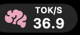
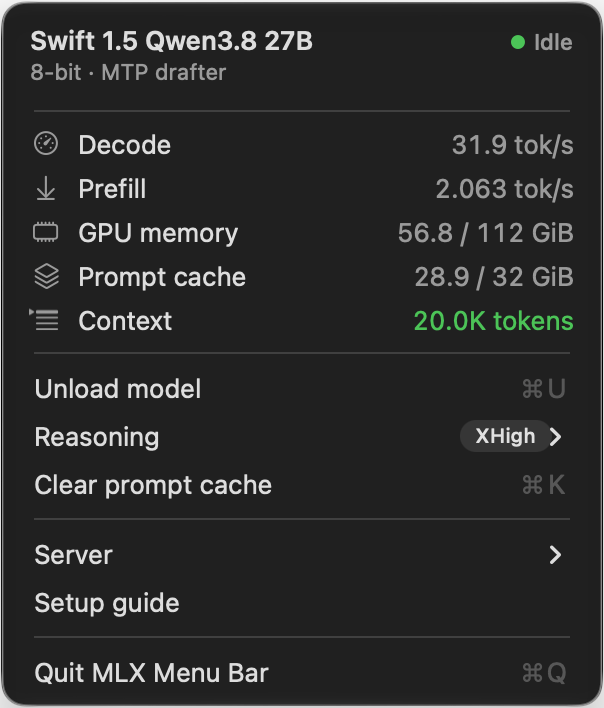

# mlx-menubar

A small native macOS menu bar app (one Swift file, no dependencies) for the MAGI server.

<p>
  &nbsp;&nbsp;
  &nbsp;&nbsp;
  
</p>



## Icon

| State | Menu bar |
| :--- | :--- |
| Reading a long prompt | pink brain, slowly pulsing, with `PROMPT` and the percentage of the prompt processed |
| Generating | pink brain (the 🧠 emoji's colour, `#F8B0C8`), slowly pulsing, with the **live** tok/s |
| Idle after a long session (≥ 80K tokens, last request < 30 min ago) | orange brain with `CONTEXT` and the size — time for a new session |
| Loaded, idle | monochrome brain |
| Not loaded / server offline | dimmed brain |
| Loading, restarting, speed test | hourglass |

Except while generating, the icon is a template image, so it follows the menu bar's light/dark appearance.

## Menu

| Item | Does |
| :--- | :--- |
| Header | Model, `8-bit · MTP drafter`, status dot |
| Decode / Prefill | Live decode speed while generating and prompt progress ("82% of 69,561 tokens") while reading; otherwise the last request's speeds |
| GPU memory | Active MLX memory / GPU limit |
| Prompt cache | In-RAM prompt cache / its cap |
| Context | Size of the current agent session: green < 40K, orange `getting slower` < 80K, red `start new session` above — see [docs/clients.md](../docs/clients.md#long-sessions-context-size-and-speed). Taken as the largest prompt within 2 minutes of the latest request (agents also send small side requests), so it can lag up to 2 minutes after `/clear` |
| Load model / Unload model (⌘L / ⌘U) | `POST /load` / `POST /unload` |
| Reasoning ▸ | Off · Low · Medium · XHigh — server default, current one shown as a badge |
| Clear prompt cache (⌘K) | Frees the in-RAM cache; hold **⌥** to also clear the disk cache |
| Server ▸ | Restart · Stop/Start (through `launchctl`) · Speed test · Copy API URL · Open server log |
| Setup guide | Opens `$MLX_SETUP_GUIDE` or `$MLX_HOME/README.md` |
| Enable GPU memory limit… | Only shown until `/etc/sudoers.d/mlx-iogpu` exists |

It also keeps the GPU limit in sync with the model state — see [docs/memory.md](../docs/memory.md#gpu-memory-limit-all-but-16-gib).

## Install

```bash
./menubar/install.sh
```

Builds `mlx-menubar.swift` with `swiftc`, ad-hoc signs it, installs it as `$MLX_HOME/mlx-menubar` and registers `~/Library/LaunchAgents/com.local.mlx-menubar.plist` so it starts at every login. Re-run after editing the Swift file.

Requires Xcode Command Line Tools. Polls `http://127.0.0.1:8080/v1/metrics` once a second, sending the key from `~/.config/magi/api-key` (or `$MAGI_API_KEY_FILE`); the live tok/s needs the server patch in [`server/patches/`](../server/patches). `MAGI_CTX_WARN` / `MAGI_CTX_NEW` (defaults 40000 / 80000) set the context thresholds.

To regenerate the dropdown screenshot: `$MLX_HOME/mlx-menubar --snapshot-menu /tmp/menu.png` opens the menu, saves it with `screencapture` (the terminal needs Screen Recording permission) and quits; crop the shadow and copy it to `assets/menubar-dropdown.png`.
